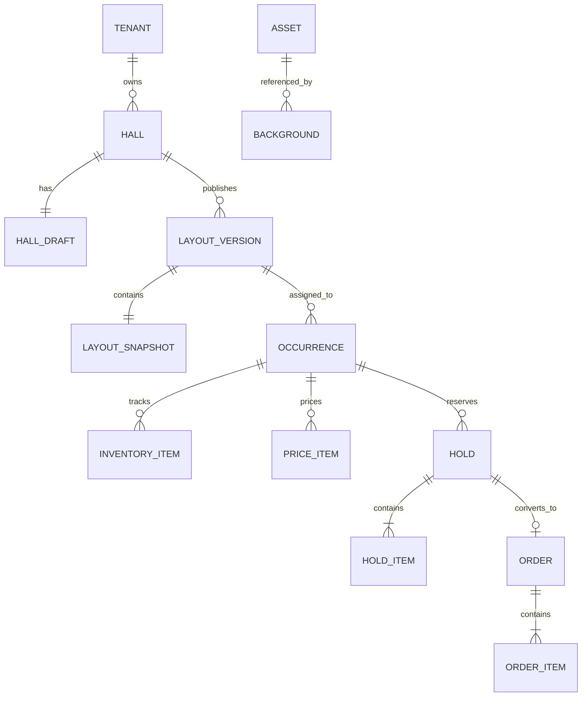

# Hall Platform — описание проекта

## 1. Что это за проект

Hall Platform — набор инструментов для создания схем залов и выбора мест на мероприятиях. Организатор строит схему в редакторе, сохраняет черновик и публикует версию. Сайт или мобильное приложение загружает схему для конкретного мероприятия, показывает цены и доступность и передаёт выбор мест серверу для удержания и оформления заказа.

Проект разделён на переиспользуемые библиотеки и демонстрационные приложения:

| Часть | Назначение |
| --- | --- |
| `libs/domain` | Предметная модель зала, схемы валидации и правила связей между объектами |
| `libs/hall-editor` | React-редактор схем для организатора |
| `libs/seat-view` | React-компонент схемы для покупателя и выбора мест |
| `libs/geometry`, `libs/renderer-*`, `libs/hall-viewer` | Геометрия, навигация по схеме и отрисовка через Konva/WebGL |
| `libs/api-contracts` | Контракты данных и OpenAPI для REST API |
| `libs/api-axios` | TypeScript-клиент для REST API |
| `libs/local-storage` | Локальное сохранение черновиков, опубликованных версий и файлов в IndexedDB |
| `apps/studio` | Демонстрационное приложение редактора и покупательского сценария |
| `apps/embed` | Пример React-приложения, встраивающего `SeatView` |

Компоненты редактора и покупательского интерфейса управляются host-приложением. Host передаёт им данные через props и обрабатывает сохранение, публикацию, выбор и покупку.

## 2. Текущий статус

- `Studio` можно запускать локально. В демонстрационном сценарии черновики залов и демо-заказы хранятся в IndexedDB браузера; внешний API для этого режима не нужен.
- `API Studio` показывает интеграцию с API при заданном `VITE_HALL_API_BASE_URL`.
- В репозитории есть OpenAPI-контракт и клиент `@hall-platform/api-axios`.
- Сервер API в этом репозитории не поставляется. В OpenAPI backend обозначен как проектируемая сторона контракта, а `http://localhost:8080` — пример адреса.
- React-пакеты помечены `private: true`; публикация в npm или другом registry пока не настроена. Компоненты рассчитаны на React и React DOM `>=19 <20`.
- Готового Flutter-пакета или мобильной нативной отрисовки сейчас нет.

## 3. Как работает API

API использует REST/JSON, префикс версии `/api/v1` и Bearer-токен. Клиент проверяет входные и выходные JSON-объекты по схемам `api-contracts`.

Основные группы маршрутов:

| Маршруты | Назначение |
| --- | --- |
| `/api/v1/halls` | Список залов и создание зала с первым черновиком |
| `/api/v1/halls/{id}` | Чтение и удаление зала |
| `/api/v1/layouts/{id}/draft` | Сохранение черновика |
| `/api/v1/layouts/{id}/validate` | Проверка схемы перед публикацией |
| `/api/v1/layouts/{id}/publish` и `/versions` | Публикация и получение истории версий |
| `/api/v1/assets/*` | Создание намерения загрузки, завершение и получение PDF-файла |
| `/api/v1/occurrences/{id}` | Схема, доступность и цены для мероприятия |
| `/api/v1/occurrences/{id}/pricing-segments` | Read-only каталог ценовых сегментов конкретного мероприятия |
| `/api/v1/occurrences/{id}/pricing-assignments` | Чтение и атомарная запись назначений для occurrence и опубликованной версии схемы |
| `/api/v1/occurrences/{id}/holds` | Создание временного удержания выбранных мест |
| `/api/v1/holds/{id}` | Чтение или отмена удержания |
| `/api/v1/orders` и `/api/v1/orders/{id}/*` | Создание заказа и вызов checkout |

### Сохранение и публикация схемы

1. Организатор загружает черновик или создаёт новый.
2. Приложение отправляет полный объект `draft` на сервер.
3. При сохранении передаёт ожидаемую `revision` через `If-Match`. Если серверная версия уже изменилась, сервер возвращает конфликт, а клиент должен перечитать данные.
4. При публикации сервер сохраняет отдельную опубликованную версию. Мероприятие связывается с конкретным `layoutVersionId`.

### Покупка билетов

1. Клиент загружает мероприятие с опубликованной схемой, текущей доступностью и ценами.
2. `SeatView` сообщает host-приложению выбранные места.
3. Host отправляет выбор на создание удержания и передаёт `availabilityRevision`.
4. Сервер проверяет наличие мест и возвращает удержание с `expiresAt` и итоговой суммой.
5. Host создаёт заказ по `holdId`, затем вызывает checkout. В контракте статус заказа может быть `pending`, `confirmed` или `cancelled`.

Все изменяющие запросы используют `Idempotency-Key`: при повторе одной сетевой операции клиент должен повторно отправлять тот же ключ. Сервер является источником истины для доступности, цен в минимальных денежных единицах, владения и срока удержания, проверки доступа tenant и опубликованных версий.

`SeatView` отвечает за интерфейс выбора. Само удержание и создание заказа выполняет host через API.

## 4. Модель зала

Черновик (`HallLayoutDraft`) содержит имя, версию схемы, снимок (`snapshot`), границы зон, PDF-файлы и калибровку координат. Снимок (`LayoutSnapshot`) содержит коллекции:

- этажи (`floors`);
- зоны (`zones`), в том числе зоны с нумерованными местами и зоны свободного размещения;
- ряды (`rows`) с геометрией прямой, дуги, кривой Безье или ломаной;
- места (`seats`) с ID, подписью, координатой и типом размещения;
- столы (`tables`);
- подложки (`backgrounds`) и декоративные объекты (`decorations`).

Объекты имеют постоянные ID и ссылаются друг на друга: зона относится к этажу, ряд — к этажу и при необходимости к зоне, место может ссылаться на ряд или стол. Для свободной зоны покупательская модель выбора содержит ID зоны и количество билетов.

Упрощённый пример черновика:

```json
{
  "schemaVersion": 2,
  "hallName": "Малый театр",
  "snapshot": {
    "id": "hall-001",
    "layoutVersionId": "version-001",
    "floors": [
      { "id": "floor-main", "layoutVersionId": "version-001", "name": "Основной этаж" }
    ],
    "zones": [
      { "id": "zone-parterre", "floorId": "floor-main", "name": "Партер", "kind": "seated" }
    ],
    "rows": [
      {
        "id": "row-a",
        "floorId": "floor-main",
        "zoneId": "zone-parterre",
        "name": "A",
        "curve": {
          "kind": "line",
          "start": { "x": 0, "y": 0 },
          "end": { "x": 10, "y": 0 }
        }
      }
    ],
    "seats": [
      {
        "id": "seat-a-1",
        "floorId": "floor-main",
        "zoneId": "zone-parterre",
        "label": "1",
        "position": { "x": 0, "y": 0 },
        "placement": { "kind": "row", "rowId": "row-a" }
      }
    ],
    "tables": [],
    "backgrounds": [],
    "decorations": []
  },
  "zoneBounds": {},
  "assets": {},
  "calibration": null
}
```

Это упрощённый фрагмент: реальные схемы могут включать больше мест, этажей, столов, геометрии, PDF-подложек и метаданных.

## 5. Данные схемы, мероприятия и продажи

Геометрия зала не содержит текущую доступность билетов или цены. Эти данные зависят от конкретного мероприятия:

```text
Организация / tenant
└── Зал
    ├── Изменяемый черновик + revision
    └── Опубликованные версии (неизменяемые)
        └── Снимок геометрии: этажи, зоны, ряды, места, столы

Мероприятие
├── Ссылка на конкретную опубликованную версию схемы
├── Доступность мест и вместимость свободных зон
├── Цены по местам и зонам
├── Удержания с владельцем и сроком истечения
└── Заказы, созданные на основе удержаний
```

В API доступность хранится по ID места или зоны. Статусы места включают `available`, `held`, `sold`, `blocked` и `unavailable`. Цена содержит `amountMinor` и валюту, например сумму в центах или копейках. Временное удержание содержит выбранные места, сумму и срок окончания. Заказ ссылается на удержание.

## 6. Как можно сохранять данные на backend

API-контракт задаёт формат JSON и жизненный цикл данных, но не фиксирует физическую схему базы. Один из подходящих вариантов реализации — хранить метаданные и транзакционные данные в реляционных таблицах, а геометрию снимка — целиком как JSONB.

Например, в PostgreSQL:

| Таблица/хранилище | Что хранить |
| --- | --- |
| `halls` | ID зала, tenant/организацию, имя, дату изменения, текущую revision |
| `hall_drafts` | Текущий документ черновика и номер ревизии |
| `layout_versions` | Неизменяемые опубликованные версии, номер версии, дату публикации и снимок JSONB |
| `occurrences` | Мероприятие и ссылку на опубликованную версию зала |
| `occurrence_inventory` | Статус места или доступную вместимость зоны для мероприятия |
| `occurrence_prices` | Цены по ID места или зоны, сумму в minor units и валюту |
| `holds` / `hold_items` | Владельца, срок действия, выбранные места/количество и серверный итог |
| `orders` / `order_items` | Заказ, статус, сумму и позиции заказа |
| `assets` + объектное хранилище | Метаданные PDF в БД и содержимое файла вне таблицы |

Такой вариант сохраняет удобный для клиента объект схемы целиком. Отдельные записи для наличия, цен, удержаний и заказов позволяют серверу атомарно блокировать место и не допускать двойную продажу. Это рекомендация по хранению; сам OpenAPI-контракт не требует именно PostgreSQL или JSONB.

В локальной демоверсии похожие сущности лежат в object stores IndexedDB (`halls`, `versions`, `assets`, `recovery` и метаданные). Это браузерное сохранение не синхронизируется между пользователями и устройствами.

### 6.1. Handoff-схема для backend-команды

Нормативный контракт обмена — `libs/api-contracts/openapi.json`; схемы Zod в `libs/api-contracts/src/contracts.ts` и доменные схемы в `libs/domain` задают текущую форму объектов. Ниже приведена логическая модель хранения. Она описывает связи и содержимое, а выбор таблиц, ORM и формата столбцов остаётся backend-команде.



| Сущность | Что нужно хранить |
| --- | --- |
| `Hall` | `id`, владелец/tenant, имя, `revision`, `updatedAt`, номер последней публикации |
| `HallDraft` | Текущий `HallLayoutDraft` и revision для optimistic concurrency |
| `LayoutVersion` | `versionId`, `hallId`, номер версии, время публикации и неизменяемый снимок схемы |
| `LayoutSnapshot` | `id`, `layoutVersionId`, массивы `floors`, `zones`, `rows`, `seats`, `tables`, `backgrounds`, `decorations` |
| `Occurrence` | ID и расписание мероприятия, ссылка на конкретный `layoutVersionId` |
| `InventoryItem` | На каждый occurrence — статус по `seatId`; для GA-зоны — доступное количество по `zoneId` |
| `PriceItem` | На каждый occurrence — цена места/зоны: `amountMinor`, ISO-код `currency`, необязательная категория |
| `Hold` / `HoldItem` | Occurrence, владелец из авторизованной сессии, выбранные места/количество, серверная сумма, срок истечения и состояние |
| `Order` / `OrderItem` | Ссылка на hold, occurrence, позиции, серверная сумма, состояние и время создания |
| `Asset` | Метаданные PDF и ссылка на объектное хранилище; бинарные данные не следует помещать в строку схемы зала |

`LayoutSnapshot` — независимое описание геометрии. Место хранит стабильный ID, этаж и зону, подпись, координату `(x, y)` и размещение (`standalone`, `row` или `table`). Ряд хранит кривую и параметры генерации; стол — форму, размеры/вместимость и позиции. Координаты задаются в мировых единицах: начало в левом верхнем углу, ось Y направлена вниз; углы поворота в модели хранятся в радианах. GA хранится как вместимость зоны, а не как синтетические seat ID.

**Что относится к залу:** черновик, версия документа и геометрия. **Что относится к occurrence:** наличие, цены, удержания и заказы. Черновик изменяемый; опубликованная версия неизменяема. Изменение черновика не меняет версию, к которой уже привязано мероприятие.

### Что API загружает и сохраняет

| Сценарий | Запрос/ответ | Что является серверной записью |
| --- | --- | --- |
| Каталог организатора | `GET /api/v1/halls` → summaries с `id`, именем, revision и счётчиками | Список залов в пределах доступа текущего tenant |
| Открыть зал | `GET /api/v1/halls/{id}` → `ApiHallRecord` с `revision` и `draft` | Серверный черновик и версия для последующего сравнения |
| Создать зал | `POST /api/v1/halls` с `{ apiVersion, draft }` и `Idempotency-Key` | Новый зал и первый черновик |
| Сохранить черновик | `PUT /api/v1/layouts/{id}/draft` с `{ apiVersion, draft }`, `If-Match: "<revision>"`, `Idempotency-Key` | Полная новая редакция черновика и увеличенная revision; устаревшая revision получает `409` |
| Опубликовать | `POST /api/v1/layouts/{id}/publish` с ожидаемой revision и `warningsAcknowledged` | Новая неизменяемая версия; ответ включает обновлённую запись и опубликованный снимок |
| Открыть покупательскую схему | `GET /api/v1/occurrences/{id}` → опубликованная геометрия, prices, availability, `ownHold` | Чтение привязанной версии и данных конкретного occurrence |
| Удержать места | `POST /api/v1/occurrences/{id}/holds` с selection и `availabilityRevision` | Сервер атомарно проверяет и резервирует места; сам вычисляет сумму и срок действия |
| Создать заказ | `POST /api/v1/orders` с `holdId`, затем `POST /api/v1/orders/{id}/checkout` | Заказ строится из удержания; клиент не задаёт доверенную сумму |

Черновик передаётся как один объект `draft`: `schemaVersion`, `hallName`, `snapshot`, `zoneBounds`, `assets`, `calibration`. `ApiHallRecord.id` совпадает с `draft.snapshot.id`. Ответ покупателю содержит только публичную часть схемы: PDF-подложки с приватными файлами удаляются из `layout`; доступность и цены всегда относятся к тому же `occurrenceId` и опубликованной версии.

Selection до запроса удержания — временное состояние host-приложения. В геометрию зала его сохранять не нужно. После `POST .../holds` выбор становится серверным удержанием с `holdId`, `expiresAt`, selection и итогом. Все изменяющие запросы используют idempotency key; владелец удержания и tenant определяются сервером по токену, а не по полям тела запроса.

### Контракт файлов PDF — требуется согласовать

Сейчас доменная схема черновика требует, чтобы `assets[assetId]` содержал `dataUrl` с PDF в Base64. Одновременно API объявляет `upload-intents` с `uploadUrl` и операцию завершения загрузки. Клиент умеет создать intent и завершить загрузку, но текущая DTO черновика всё ещё требует Base64-данные. До реализации PDF-сохранения backend-команде и frontend нужно согласовать wire-формат: оставить Base64 в `draft` либо изменить API DTO так, чтобы черновик хранил ссылку на asset, а байты шли отдельной загрузкой. Рекомендуемый для больших PDF вариант — отдельная загрузка бинарного файла и ссылка/метаданные в черновике; это потребует согласованного изменения DTO и клиента.

### Что считать источником истины

Этот handoff описывает текущий контракт `tickets-frontend` с маршрутами `/api/v1/...`. Файл `../seating-configurator.md` описывает другой C# API с маршрутами `/api/seating-configurations` и другой моделью ревизий. Backend-команда должна либо реализовать текущий OpenAPI, либо согласовать отображение между двумя контрактами до начала интеграции; это не взаимозаменяемые DTO.

## 7. Использование из Flutter

Flutter-клиент может обращаться к REST API по HTTPS через `dio` или `http`. Он загружает JSON мероприятия, преобразует `layout.snapshot` в свои модели и рисует схему нативными средствами Flutter, например с помощью `CustomPainter`.

```dart
final dio = Dio(BaseOptions(
  baseUrl: apiBaseUrl,
  headers: {'Authorization': 'Bearer $accessToken'},
));

final response =
    await dio.get('/api/v1/occurrences/$occurrenceId');
final occurrence = response.data as Map<String, dynamic>;
final snapshot = occurrence['layout']['snapshot'];
final availability = occurrence['availability'];
final prices = occurrence['prices'];

// Отрисовать snapshot['floors'], snapshot['zones'], snapshot['seats'].

final holdResponse = await dio.post(
  '/api/v1/occurrences/$occurrenceId/holds',
  data: {
    'apiVersion': 'v1',
    'availabilityRevision': availability['revision'],
    'selection': [
      {'kind': 'seat', 'seatId': selectedSeatId},
    ],
  },
  options: Options(headers: {'Idempotency-Key': holdAttemptUuid}),
);

final hold = holdResponse.data;
// Показать серверную сумму и hold['expiresAt'].
```

Для свободной зоны вместо места отправляется элемент вида:

```json
{ "kind": "generalAdmission", "zoneId": "zone-standing", "quantity": 2 }
```

Затем мобильное приложение создаёт заказ с `holdId` и вызывает checkout. Для каждого действия создаётся свой idempotency key; при повторе той же операции сохраняется прежний ключ.

Готового Flutter SDK сейчас нет. Flutter использует общий backend API и модель JSON, но интерфейс выбора реализует нативно. Если нужно переиспользовать React-отрисовку, её можно загрузить в WebView; текущий `createSeatViewEmbed` рассчитан на DOM и React DOM.

## 8. Использование в React-приложениях

### Покупательская схема

Host загружает мероприятие, преобразует API-ответ функцией `mapBuyerOccurrence`, хранит выбор в своём состоянии и передаёт его в `SeatView`:

```tsx
import { useState } from 'react';
import { SeatView, type SeatSelectionItem } from '@hall-platform/seat-view';
import '@hall-platform/design-tokens/styles.css';
import '@hall-platform/seat-view/styles.css';

function Booking({ occurrence, api }) {
  const [selection, setSelection] = useState<SeatSelectionItem[]>([]);

  return (
    <SeatView
      layout={occurrence.layout}
      occurrenceId={occurrence.id}
      availability={occurrence.availability}
      availabilityRevision={occurrence.availabilityRevision}
      prices={occurrence.prices}
      selection={selection}
      locale="ru-RU"
      onSelectionChange={setSelection}
      onBuyClick={async ({ selection: items }) => {
        const hold = await api.createHold(
          occurrence.id,
          items,
          crypto.randomUUID(),
          occurrence.availabilityRevision,
        );
        // Показать подтверждение удержания и обновить данные мероприятия.
      }}
      onError={(error) => console.error(error)}
    />
  );
}
```

### Редактор зала

`HallEditor` также контролируемый: host хранит черновик и связывает действия с API.

```tsx
<HallEditor
  value={draft}
  onChange={setDraft}
  onSave={async (nextDraft) => {
    const saved = await api.saveDraft(
      nextDraft,
      revision,
      crypto.randomUUID(),
    );
    setRevision(saved.revision);
  }}
  onPublish={async (nextDraft, warningsAcknowledged) => {
    return api.publishDraft(
      nextDraft,
      revision,
      crypto.randomUUID(),
      warningsAcknowledged,
    );
  }}
  onError={reportError}
/>
```

### Встраивание без собственного React root

`@hall-platform/seat-view` предоставляет `createSeatViewEmbed(element, options)`. Метод `update()` передаёт новые данные схемы, мероприятия, цен и доступности. `dispose()` удаляет root и освобождает ресурсы. Это прямое встраивание в DOM; iframe и `postMessage` не используются.

## 9. Библиотека, сервер и приложения

Hall Platform состоит из двух типов частей:

1. **Клиентские библиотеки** (`hall-editor`, `seat-view`, `domain`, рендереры) подключаются к приложению. В React они исполняются внутри приложения и входят в его web-сборку.
2. **Backend API** запускается и разворачивается отдельно. Он хранит общие данные, проверяет доступность и создаёт удержания и заказы. Мобильный клиент обращается к нему по HTTPS.

React-библиотеку не требуется отдельно разворачивать как сервер, чтобы Flutter отправлял к ней HTTP-запросы. Flutter общается по HTTP с backend API. Если Flutter должен показывать готовый React-компонент, понадобится WebView с web-сборкой; иначе Flutter использует API и сам рисует схему.

Перед использованием в стороннем React-приложении пакеты нужно опубликовать во внутренний registry или подключить иным способом: сейчас они `private: true` и доступны как workspace-пакеты внутри этого Nx workspace.

## 10. Важные оговорки по документации

- Основной код этой библиотеки находится в `tickets-frontend`; соседний каталог `hall-platform` содержит Nx-шаблон.
- Файл `../seating-configurator.md` ссылается на отдельный C# backend в другом проекте и описывает маршруты `/api/seating-configurations`. Текущий frontend-контракт находится в `libs/api-contracts/openapi.json` и использует `/api/v1/halls` и `/api/v1/occurrences`. Перед реализацией backend эти контракты нужно согласовать.
- API-контракт описывает требуемые операции и ответы; его наличие не означает, что сервер уже реализован или развёрнут.

## Ссылки по коду

- `README.md` — запуск демо и примеры интеграции компонентов.
- `libs/domain/src/lib/model/layoutSnapshot.ts` — структура снимка схемы.
- `libs/domain/src/lib/model/hallLayoutDraft.ts` — структура черновика.
- `libs/api-contracts/src/contracts.ts` и `libs/api-contracts/openapi.json` — API-модели и HTTP-контракт.
- `libs/api-axios/src/client.ts` — TypeScript API-клиент.
- `apps/studio/src/pages/api/ApiStudioPage.tsx` — пример редактора и покупки через API.
- `libs/local-storage/src/lib/storageDatabase.ts` — IndexedDB-хранилища демо.

## 11. Ценовые сегменты

`@hall-platform/pricing-editor` предоставляет контролируемый экран для назначения
каталога ценовых сегментов местам, seated-зонам и GA-зонам. Каталог приходит с
backend и доступен только для чтения. Документ назначений относится к одному
`occurrenceId` и одному `layoutVersionId`; геометрия и опубликованный снимок зала
не меняются.

Для React host импортирует `PricingEditor`, `PricingAssignmentDocument` и
`PricingCatalog` из публичных workspace-пакетов. Host загружает схему,
`GET /api/v1/occurrences/{id}/pricing-segments` и
`GET /api/v1/occurrences/{id}/pricing-assignments`, передаёт их в компонент,
сохраняет черновик через `onChange` и выполняет атомарный PUT из `onSave`.
Запись содержит контекст, стабильные segment IDs и ожидаемую revision через
`If-Match`; для одного тела запроса повторно используется тот же
`Idempotency-Key`. При неизвестном результате сетью нужно сохранить попытку и
повторить прежние body/key, а не создать новую операцию.

Назначение seated-зоне объединяет явные связи и места, центр которых находится в
её polygon или явно сохранённых bounds. Одна команда назначает сегмент каждому
найденному месту, включая замену прежних ручных исключений. Поздняя команда для
отдельного места может снова создать исключение; следующая команда всей зоне
заменит и его. Пересечение геометрической зоны и связей отображается как
диагностика, а повторяющиеся цели дедуплицируются. Неявные renderer bounds для
назначений не применяются.

GA определяется только явным `kind: "ga"`; её capacity остаётся частью схемы,
а цена задаётся за билет. Если в GA обнаружены места по связи или геометрии,
назначение блокируется, чтобы не создавать два вида инвентаря для одних целей.
Неполное покрытие разрешено для настройки, но объект без активного сегмента
показывается как без цены и не проходит проверку `SeatView` для покупки. Нулевая
цена считается бесплатной только для явно назначенного активного сегмента с
`amountMinor: 0`.

Для предпросмотра используйте `createPricingPreviewPriceMap` и существующий
`SeatView` с `purchaseDisabled`. Preview отражает черновик и не создаёт hold или
order. После серверного сохранения API Studio заново загружает occurrence и
передаёт покупателю серверную карту цен. Если серверная котировка hold отличается
от суммы, показанной до удержания, host требует явного подтверждения новой суммы.

Flutter и React WebView не реализуют отдельный pricing editor для продаж: они
используют тот же endpoint occurrence и server-owned цены, availability, holds и
orders. Если администратору нужен редактор в WebView, это отдельная встройка
React-компонента, а не часть покупательского checkout.

В репозитории реализованы доменная модель, UI, demo persistence, клиентские DTO,
OpenAPI и API Studio mock flow. Backend, его хранилище и реальная интеграционная
приёмка здесь отсутствуют. Перед production требуется согласовать с backend
командой статусы ошибок, auth, ревизии, актуальность цен в occurrence и правила
неизменяемых котировок holds/orders. Наличие OpenAPI или mock-тестов само по себе
не подтверждает работу серверных маршрутов.
